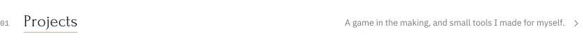
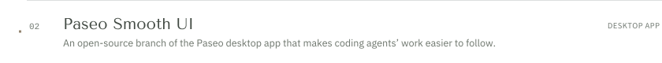
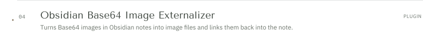
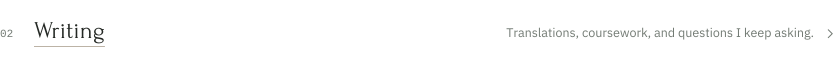

<a href="https://feixqe.com/"><picture><source media="(prefers-color-scheme: dark)" srcset="assets/header-dark.svg"></picture></a>

<a href="https://feixqe.com/#works"><picture><source media="(prefers-color-scheme: dark)" srcset="assets/projects-dark.svg"></picture></a> 
<picture><source media="(prefers-color-scheme: dark)" srcset="assets/group-lead-dark.svg"></picture> 
<a href="https://feixqemn.github.io/pending-demo/"><picture><source media="(prefers-color-scheme: dark)" srcset="assets/pending-dark.svg"></picture></a> 
<picture><source media="(prefers-color-scheme: dark)" srcset="assets/group-more-dark.svg"></picture> 
<a href="https://github.com/feixqemn/paseo-smooth-ui"><picture><source media="(prefers-color-scheme: dark)" srcset="assets/paseo-dark.svg"></picture></a> 
<a href="https://github.com/feixqemn/youtube-live-subtitle-sync"><picture><source media="(prefers-color-scheme: dark)" srcset="assets/subtitle-shift-dark.svg"></picture></a> 
<a href="https://github.com/feixqemn/obsidian-base64-image-externalizer"><picture><source media="(prefers-color-scheme: dark)" srcset="assets/conversations-dark.svg"></picture></a> 
<a href="https://github.com/feixqemn/msi-monitor-hid"><picture><source media="(prefers-color-scheme: dark)" srcset="assets/monitor-dark.svg"></picture></a> 
<a href="https://feixqe.com/#texts"><picture><source media="(prefers-color-scheme: dark)" srcset="assets/writing-dark.svg"></picture></a> 
<a href="https://feixqe.com/#about"><picture><source media="(prefers-color-scheme: dark)" srcset="assets/about-dark.svg"></picture></a>

<a href="https://feixqe.com/">feixqe.com</a> &nbsp;·&nbsp; <a href="mailto:feixqe@outlook.com">feixqe@outlook.com</a>
